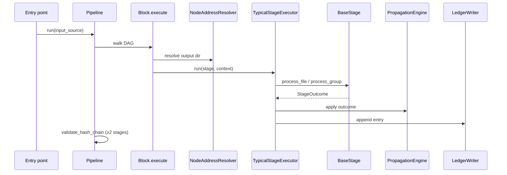
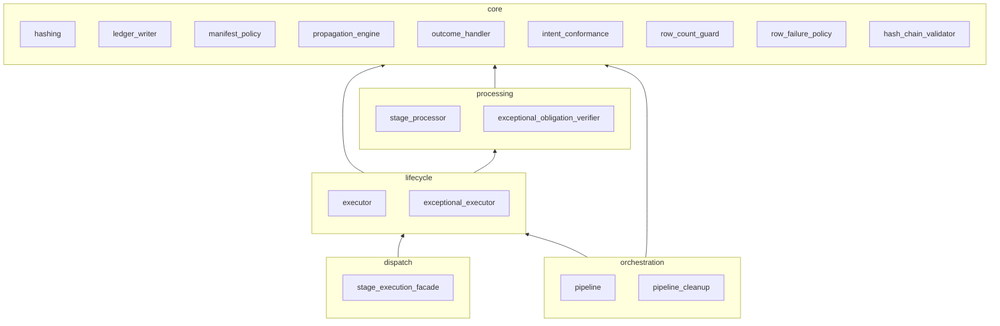

# Plinth internals

How the engine is put together, for contributors working on `src/plinth/`.

## Responsibility map

| Component | Module(s) | Owns |
|-----------|-----------|------|
| DAG traversal | `blocks.py`, `block_executors.py`, `block_dag.py`, `dag_structures.py` | Topology execution order only |
| Stage dispatch | `stage_execution_facade.py` | Blocks → typical/exceptional executor routing |
| Pipeline orchestration | `runtime/pipeline.py`, `runtime/pipeline_cleanup.py` | Run entry, resume/cleanup, hash-chain validation |
| Node addressing | `address/resolver.py` | Sole derivation of on-disk directory names |
| Typical lifecycle | `runtime/executor.py`, `runtime/stage_processor.py` | Row iteration, outcome application, intent conformance |
| Exceptional lifecycle | `runtime/exceptional_executor.py`, `runtime/exceptional_obligation_verifier.py` | Full-stage execute + obligation checks |
| Manifest propagation | `runtime/propagation_engine.py` (via blocks) | Manifest merge/replace, schema copy |
| Ledger | `runtime/ledger_writer.py` | Sole writer of `metadata_ledger.yaml` |
| Provenance hashing | `runtime/hashing.py` | Directory hashes over rows, schema and files |
| Hash chain | `runtime/hash_chain_validator.py` | Post-run contiguity validation |
| Row failure policy | `runtime/row_failure_policy.py` | Fail-fast default; opt-in partial success |
| Config | `config.py` | Typed pipeline config validation |
| Registration | `registry.py` | Stage lookup; exceptional list |

**Rule:** Stages write domain files and declared auxiliary artifacts only. Stages never write ledger files directly.

## Runtime flow (typical)

## Runtime flow (exceptional)

`ExceptionalStageExecutor` delegates to `stage.execute(context)`, then `exceptional_obligation_verifier` checks ledger, manifest handoff, and resolver-derived address.

## Data ownership

| Artifact | Writer |
|----------|--------|
| `manifest.csv` | Propagation engine |
| `dataset_schema.yaml` | Propagation engine (`DatasetSchema.to_yaml`, schema format 1) |
| `metadata_ledger.yaml` | `LedgerWriter` only |
| Data files (under `<media.subdir>/`) | Stage domain logic |
| Declared sidecars | Stage (must register auxiliary intent) |

## Address authority

All consumers — execute, JSONPath skip/resume, cleanup prefix walk, discovery parse — must agree on directory paths. Integration gate: `tests/invariants/test_address_consumer_agreement.py`.

## Provenance hashes

Each ledger entry records `input_hash` and `output_hash` of the stage's directories (`compute_directory_hash`). A directory hash covers everything in it except `metadata_ledger.yaml`, each item keyed by its relative path:

| Item | Digest |
|------|--------|
| `manifest.csv` | Canonical rows (`normalize_manifest_rows`): row and column order and the location of `<path_column>` are ignored; every cell counts |
| `dataset_schema.yaml` | Parsed YAML content |
| Any other file | SHA-256 of its bytes, read in chunks |

So rows with no files still hash their data, editing a cell changes the hash, and renaming or re-pointing a file changes it too. Hashes do not depend on where the run directory lives.

Blocks that merge their children's outputs into a block directory (`aggregate_outputs`) record an aggregation in the ledger (`aggregations`: block name, input directory hashes, merged directory hash). The hash-chain validator accepts a stage input that is the previous stage's output, an input an earlier stage shared (parallel siblings), or a recorded aggregation whose inputs, transitively, are directories earlier stages produced and include the previous stage's output.

## Failure policies

| Policy | Behavior | Default |
|--------|----------|---------|
| Row failure | Fail stage on first row error | Yes (fail-fast) |
| Partial success | Opt-in via `allow_partial_success`, `max_dropped_rows` on `StageIntent` | Off |
| Parallel branch | `parallel_error_policy: fail_fast` aborts entire parallel block on first branch failure | fail_fast |
| Hash chain | Broken contiguity aborts pipeline after run | Always on ≥2 stages |
| Intent conformance | Missing columns / structural violations fail stage | Always |

## Manifest replace truth table

| Intent flags | Behavior |
|--------------|----------|
| `filters_rows`, `expands_rows`, or `aggregates_rows` | Full manifest replace after stage |
| Column updates only (`write_columns`, no structural flags) | In-place merge per row |
| Exceptional `replace=True` on context | Full replace at author request |

Implementation: `TypicalStageExecutor` + propagation engine; verified by golden tiers and intent conformance tests.

## Propagation and resume

- **File copy vs reference:** When `modifies_files=False`, file paths (the schema's `media.path_column`) propagate by reference (relative `<subdir>/<file name>` when possible). When `modifies_files=True`, files copy into the stage output tree under `media.subdir`. Rows without a file pointer reach `process_file` with `NO_SOURCE_FILE` and are never propagated.
- **Skip/resume:** JSONPath expressions select stage nodes; resolved paths must match `NodeAddressResolver` output. Invalid indices raise before execution. See `tests/invariants/test_address_consumer_agreement.py` skip/resume cases.
- **Resume params:** Upstream `params_hash` in preserved ledgers must match current config when resuming; see `validate_upstream_params_on_resume` in `resume_policy.py`.
- **Worked examples:** GT2 sequential fixture (`tests/fixtures/golden_pipeline/tiers/gt2/`) and GT3 parallel join fixture (`tiers/gt3/`).

## Dataset schema resolution

Every stage directory carries a `dataset_schema.yaml` written by `DatasetSchema.to_yaml`: all fields
explicit (`unique_key`, `identity` with `key_types`/`key_defaults`, `columns`, `media`) plus
`schema_format: 1`. How a stage obtains its schema:

| Situation | Schema used |
|-----------|-------------|
| Input dir has a `dataset_schema.yaml` in the current format | Exactly what the file says |
| Input dir has a file **without** `schema_format`, or with another format | Rejected (`ValueError`) — schema files must be explicit |
| Input dir has no `dataset_schema.yaml` | `DatasetSchema()` — flat identity (`entity_id`), `MediaSpec()` (`file_path` / `files`) |
| Multiple input dirs (`MultiInputStageContext`, block aggregation) | First schema file seeds `unique_key`, `identity`, `media`; later files must agree (an empty first schema defers to the next one) and columns are unioned |
| `InMemoryStageContext` / `plinth.testing` helpers | The schema passed in, else `DatasetSchema()` |

The executor builds the output manifest with the context schema, and the stage processor's
fallback loader reads the input directory's schema, so identity normalization is consistent across
a run. The parsed schema is part of each directory hash (see §Provenance hashes), so a schema change
shows up in the ledger.

## Flow control (arming overlay)

Flow control is **orthogonal** to DAG topology and to `start_from_paths` / `end_at_paths` run windows:

| Concern | Owner | YAML surface |
|---------|-------|--------------|
| Topology | `dag` (`sequential` / `parallel` / `stage`) | `dag` |
| Run window | Resume/cleanup JSONPath | `start_from_paths`, `end_at_paths` |
| Arming | Run-scoped overlay | `flow_arming` |

`flow_arming` keys:

- `disarmed_ports`: port ids (`{parallel_block}/{child}`) forced **disarmed** for this run.
- `parallel_policies`: per parallel block fan-in policy — `wait_mode` (`wait_all` / `wait_armed`), `combine_mode` (`aggregate`), optional `armed_children`.

Runtime wiring (`plinth/flow/`):

1. `Pipeline.run` builds `FlowRunContext` when `flow_arming` is active and attaches it to the DAG config dict (`_flow_run_context`, `_flow_arming_hash`).
2. `ParallelBlock` consults the overlay — disarmed branches are not executed; fan-in resolves live paths before aggregate.
3. Typical and exceptional executors stamp `arming_hash` on ledger entries.
4. Resume validates upstream `arming_hash` against the current run identity (mirrors the resume params drift gate).

Port readiness model: **unconnected** (no upstream path), **disarmed** (masked by overlay), **armed** (eligible for combine). Disarmed ≠ empty output — disarmed branches are skipped entirely.

Config validation rejects unknown ports, unknown parallel blocks, unknown `armed_children`, and contradictory disarm/arm pairings.

## Extension points

- Register stages at the application entry point (e.g. a `register_stages()` function)
- Add a golden tier (`tests/golden/`) before relying on a new DAG topology
- Add a row to the [expectation matrix](expectation_matrix.md), with a positive and a negative test, for each new guarantee

## Dependency layering

`plinth` must not import application stages or entry scripts; applications import `plinth`, never the reverse. Enforced by import-linter in CI.

### Runtime subpackage layering

Import-linter contract `runtime-layering` enforces the acyclic order for core runtime modules (orchestration → lifecycle → processing → core). `exceptional_obligation_verifier` spans the address/blocks boundary and is documented but excluded from the mechanical contract.

## Related docs

- Author contract: [stage_author_contract.md](stage_author_contract.md)
- Testing recipe: [testing_recipe.md](testing_recipe.md)
- Changelog: [CHANGELOG.md](../CHANGELOG.md)
